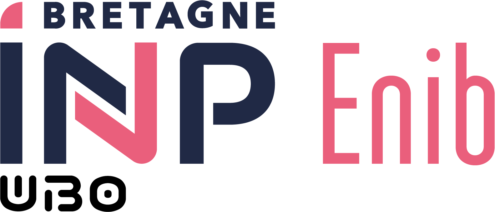
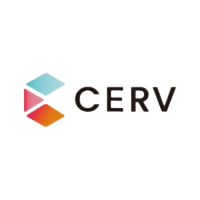
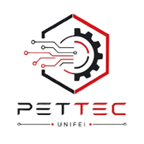

  

 

## About Me

I am an engineering student pursuing a **Brazil–France double degree** between **UNIFEI** (*Universidade Federal de Itajubá*) and **ENIB** (*École Nationale d'Ingénieurs de Brest*). Throughout my academic path, I also took part in **PETTec** (*Tutorial Education Program*) at UNIFEI, collaborating on technical projects, teaching initiatives, and competitive programming.

Currently, I am conducting research at **CERV** (*Centre Européen de Réalité Virtuelle*), where I work primarily with **Python**, **ROS**, and the **Gazebo** simulator on the **LIMO** mobile robot. Beyond robotics and simulation, I enjoy exploring **Vision-Language Models**, **graph algorithms**, and **software engineering**.

 

## Academic & Research

  <table>
    <tr>
      <td align="center" width="185">
        
          
        <b>UNIFEI</b> 
        Home University · Brazil
      </td>
      <td align="center" width="185">
        
          
        <b>ENIB</b> 
        Double Degree · France
      </td>
      <td align="center" width="185">
        
          
        <b>CERV</b> 
        Robotics &amp; VR Research
      </td>
      <td align="center" width="185">
        
          
        <b>PETTec</b> 
        Former Member · UNIFEI
      </td>
    </tr>
  </table>

 

## Tech Stack

  
    
  
  
  

 

## Selected Work

### [limo-offline-learning](https://github.com/jupivato/limo-offline-learning)
`Python` · `ROS` · `Gazebo` · `LIMO`

Offline learning experiments developed for the LIMO mobile robot, combining Python control pipelines with ROS and Gazebo simulation environments.

### [POC-Nemotron-Nano-12B-V2-VL](https://github.com/jupivato/POC-Nemotron-Nano-12B-V2-VL)
`Python` · `Jupyter Notebook` · `Vision-Language Models`

Proof of concept evaluating the Nemotron Nano 12B V2 Vision-Language model on multimodal inference tasks.

### [MST-Kruskal-Algorithm](https://github.com/jupivato/MST-Kruskal-Algorithm)
`Python` · `Graph Theory`

Implementation of Kruskal's Minimum Spanning Tree algorithm over randomly generated graphs, paired with a visual representation of the resulting tree.

### [Bon-Appetit-Hub](https://github.com/jupivato/Bon-Appetit-Hub)
`TypeScript` · `Web Development`

Web application built with TypeScript, focused on clean structure and user-friendly interface design.

 

<b>More repositories &amp; academic coursework</b>

 

- **[programming-marathon](https://github.com/jupivato/programming-marathon)** (`LaTeX`) — Competitive programming notes, algorithms, and reference material.
- **[Sorting-algorithms](https://github.com/jupivato/Sorting-algorithms)** (`C++`) — Classic sorting algorithms implemented and compared in C++.
- **[FreeCell](https://github.com/jupivato/FreeCell)** (`C`) — Classic FreeCell card game implemented in C.
- **[Hogwarts-Legacy-Java-Implementation](https://github.com/jupivato/Hogwarts-Legacy-Java-Implementation)** (`Java`) — Object-oriented design patterns project in Java.
- **[Hogwarts-Legacy-Database-Java-Implementation](https://github.com/jupivato/Hogwarts-Legacy-Database-Java-Implementation)** (`Java`) — Database integration project in Java.

 

## Contributions

  <picture>
    <source media="(prefers-color-scheme: dark)" srcset="./assets/snake-dark.svg" />
    <source media="(prefers-color-scheme: light)" srcset="./assets/snake-light.svg" />
    
  </picture>

 

## Connect

  
  
  

