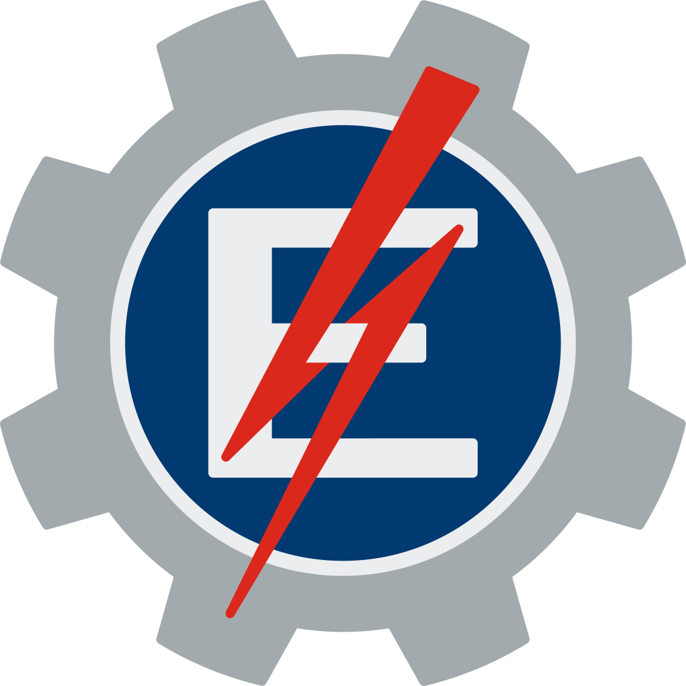

<!-- Header Wave Banner -->

 

<!-- Quick Status Pills -->

 

<!-- Two-Column Dashboard: About Me + GitHub Streak -->
<table>
  <tr>
    <td width="54%" valign="top">
      <h3>✨ About Me</h3>
      <ul>
        <li>🎓 Pursuing a <b>Brazil–France Double Degree</b> in Engineering at <b>UNIFEI</b> & <b>ENIB</b>.</li>
        <li>🥽 Conducting research at <b>CERV</b> (<i>Centre Européen de Réalité Virtuelle</i>).</li>
        <li>🤖 Working with <b>Python</b>, <b>ROS</b>, and <b>Gazebo</b> simulations on the <b>LIMO</b> robot.</li>
        <li>💡 Former member of <b>PETTec</b> (Tutorial Education Program) at UNIFEI.</li>
        <li>🧩 Passionate about <b>algorithms</b>, <b>AI/VLMs</b>, and clean software architecture.</li>
      </ul>
    </td>
    <td width="46%" align="center" valign="middle">
      
    </td>
  </tr>
</table>

 

### 🏛️ Academic & Research Journey

  <table>
    <tr>
      <td align="center" width="180">
        
          
        <b>UNIFEI</b> 🇧🇷 
        Home University
      </td>
      <td align="center" width="180">
        
          
        <b>ENIB</b> 🇫🇷 
        Double Degree
      </td>
      <td align="center" width="180">
        
          
        <b>CERV</b> 🥽 
        Robotics & VR Research
      </td>
      <td align="center" width="180">
        
          
        <b>PETTec</b> 💡 
        Alumni • UNIFEI
      </td>
    </tr>
  </table>

 

### 🛠️ Tech Stack & Environment

  <table>
    <tr>
      <td align="center" width="50%">
        <b>Languages</b>  
        
      </td>
      <td align="center" width="50%">
        <b>Robotics, Simulation & Tools</b>  
        
          
        
        
        
      </td>
    </tr>
  </table>

 

### 🚀 Featured Projects

<table>
  <tr>
    <td width="50%" valign="top">
      <a href="https://github.com/jupivato/limo-offline-learning"><b>🤖 limo-offline-learning</b></a>
       <code>Python</code> • <code>ROS</code> • <code>Gazebo</code>
        
      Offline learning experiments with the LIMO mobile robot in simulated environments.
    </td>
    <td width="50%" valign="top">
      <a href="https://github.com/jupivato/POC-Nemotron-Nano-12B-V2-VL"><b>🧠 POC-Nemotron-Nano-12B-V2-VL</b></a>
       <code>Python</code> • <code>Jupyter</code> • <code>VLM</code>
        
      Proof of concept exploring the Nemotron Nano 12B V2 Vision-Language model.
    </td>
  </tr>
  <tr>
    <td width="50%" valign="top">
      <a href="https://github.com/jupivato/MST-Kruskal-Algorithm"><b>🕸️ MST-Kruskal-Algorithm</b></a>
       <code>Python</code> • <code>Graphs</code>
        
      Kruskal's Minimum Spanning Tree algorithm with visual graph representation.
    </td>
    <td width="50%" valign="top">
      <a href="https://github.com/jupivato/Bon-Appetit-Hub"><b>🍽️ Bon-Appetit-Hub</b></a>
       <code>TypeScript</code> • <code>Web</code>
        
      Full-featured web application built with TypeScript.
    </td>
  </tr>
</table>

<b>📂 More repositories & coursework</b> — <i>click to expand</i>

 

- **[programming-marathon](https://github.com/jupivato/programming-marathon)** (`TeX`) — Competitive programming notes and reference material in LaTeX.
- **[Sorting-algorithms](https://github.com/jupivato/Sorting-algorithms)** (`C++`) — Classic sorting algorithms implemented and benchmarked in C++.
- **[FreeCell](https://github.com/jupivato/FreeCell)** (`C`) — Classic FreeCell card game implemented in C.
- **[Hogwarts-Legacy-Java-Implementation](https://github.com/jupivato/Hogwarts-Legacy-Java-Implementation)** (`Java`) — Object-oriented design patterns project in Java.
- **[Hogwarts-Legacy-Database-Java-Implementation](https://github.com/jupivato/Hogwarts-Legacy-Database-Java-Implementation)** (`Java`) — Database integration project in Java.

 

### 🐍 Contributions

  <picture>
    <source media="(prefers-color-scheme: dark)" srcset="./assets/snake-dark.svg" />
    <source media="(prefers-color-scheme: light)" srcset="./assets/snake-light.svg" />
    
  </picture>

 

### 📫 Connect

  

